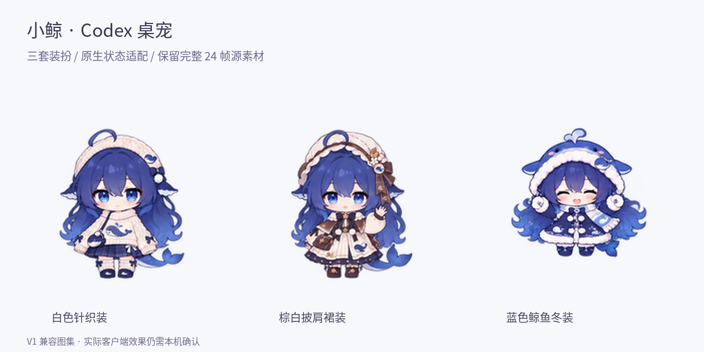

# 小鲸 · Codex 桌宠



三套蓝发鲸尾女孩装扮：**白色针织装、棕白披肩裙装、蓝色鲸鱼冬装**。这是由已有逐帧素材适配而成的 Codex 自定义桌宠资源包，不是独立 Electron 应用，也不需要额外的模型或 API Key。

> **兼容性边界**：本包采用 OpenAI `hatch-pet` 文档中核验的 **V1 8×9 兼容图集**，不是带视线方向扩展的 V2 图集。已完成资源、安装器与离线逻辑测试，**尚未在真实 Codex Desktop 实例内验证**。不同客户端版本的发现、加载和状态触发仍需本机确认。详见 [兼容性说明](docs/COMPATIBILITY.md)。

## 安装

完整解压后，在本目录执行：

**macOS / Linux：**

```bash
bash install.sh
```

macOS 也可双击 `install.command`。安装脚本需要 Python 3.10 或更新版本，仅使用标准库；安装不需要 Pillow，不需要 Node，也不联网。

**Windows PowerShell：**

```powershell
py -3 tools/petctl.py install
```

也提供 `install.ps1` 包装脚本。若系统的 PowerShell 脚本执行策略限制运行，直接使用上面的 Python 命令，无需修改全局执行策略。

默认安装位置：

```text
${CODEX_HOME:-$HOME/.codex}/pets/
├── whale-knit/
│   ├── pet.json
│   └── spritesheet.webp
├── whale-cape/
│   ├── pet.json
│   └── spritesheet.webp
└── whale-winter/
    ├── pet.json
    └── spritesheet.webp
```

Windows 未指定 `CODEX_HOME` 时，对应 `%USERPROFILE%\.codex\pets\`。

没有 Python 时，可以手动把 `pets/` 下的三个文件夹复制到上面的 `pets` 目录。发现同名目录时先自行备份，不要覆盖其他桌宠。

安装后完整退出并重新打开 Codex，进入 **设置 → Pets**，选择“小鲸 · 白色针织装”等条目；用 `/pet` 或界面中的 Show pet 显示桌宠。三套装扮是三个独立可选条目，**不是同一个条目中的自动换装功能**。菜单位置以本机版本为准。

### 安全安装选项

```bash
# 查看计划，不写文件
python3 tools/petctl.py install --dry-run

# 只装冬装
python3 tools/petctl.py install --outfit winter

# 自定义 Codex 用户目录
python3 tools/petctl.py install --home /path/to/codex-home

# 已安装版本有变化时，先备份再替换；完全相同的文件会跳过
python3 tools/petctl.py install --force

# 卸载也是移入备份目录，不直接永久删除
python3 tools/petctl.py uninstall --outfit winter
```

旧版本备份在 `<CODEX_HOME>/pet-backups/`。安装器只操作本包的三个 ID，不修改 `config.toml`、登录信息、对话记录或其他桌宠，不会替用户修改 Codex 全局选择状态。遇到同名但身份不匹配的目录会停止，不因 `--force` 跳过保护。

## 动作与帧数

原始素材每套 9 个动作、每动作 24 帧，共 **648 帧**，完整保存在 `assets/source/` 的 **27 张无损 WebP 图集**中。原生 Codex V1 只读取固定行和固定帧数，因此原生包选取了关键帧，不能直接按 24 帧播放。

| Codex 状态 | 本包表现 | 原生帧数 | 来源 |
|---|---|---:|---|
| `idle` | 安静眨眼 | 6 | 歪头眨眼 |
| `running-right` | 向右小碎步 | 8 | 小碎步走路 |
| `running-left` | 向左小碎步 | 8 | 向右动作镜像 |
| `waving` | 软萌挥手 | 4 | 挥手 |
| `jumping` | 开心小蹦 | 5 | 跳跃 |
| `failed` | 哎呀，捂脸了 | 8 | 惊讶捂脸 |
| `waiting` | 坐着等你回应 | 6 | 坐着晃脚摆尾 |
| `running` | 歪头思考 | 6 | 歪头眨眼的一个片段 |
| `review` | 认真看看 | 6 | 歪头眨眼的另一个片段 |

`running` 是 Codex 的工作状态，不是字面意义的奔跑。本次没有新画“敲键盘”和“检查代码”动作，工作与检查复用了不同待机片段。向左行走使用镜像，所以不对称的帽饰、包带也会换边。

原始的轻快小跑、困困点头、开心摇摆仍可在完整 24 帧模式下预览与导出，**没有额外接到原生 Codex 状态中**。本仓库不伪造 Codex 事件监听器：何时切换原生状态，由客户端决定。

## 离线预览

直接打开 `preview.html`。页面无需服务器、无需联网，提供原生状态 / 完整 24 帧两种模式，三套装扮同步预览，支持暂停、逐帧、调速和背景切换。点击角色可预览挥手。预览页是素材检查工具，**不连接正在运行的 Codex 会话**。

`assets/previews/` 中的 GIF 只用于预览，带有浅色背景。真正安装的是透明 `spritesheet.webp`，不是 GIF。

## 源素材、重建与验证

安装不需要图像库；只有导出原帧、重建和图像校验需要 Pillow。

```bash
python3 -m pip install Pillow

# 导出全部 648 张透明 PNG 到一个空目录
python3 tools/build.py export-frames ./exported-frames

# 根据 config.json 的关键帧映射重建 3 套原生包
python3 tools/build.py build

# 图像、完整帧哈希、图集尺寸、透明边界检查
python3 tools/build.py validate

# 安装文件校验（标准库，无 Pillow 依赖）
python3 tools/petctl.py verify

# 运行测试
python3 -m unittest discover -s tests -v
```

如果需要从此前的完整 PNG 素材压缩包重新导入，可执行：

```bash
python3 tools/build.py import-zip /path/to/original-art.zip
python3 tools/build.py build
```

源帧使用无损编码，透明像素中的不可见 RGB 被统一归零；可见颜色和 Alpha 保留。`assets/source/manifest.json` 保存每帧的归一化 RGBA 哈希，可验证 648 帧的无损往返。导出 PNG 视觉内容相同，但不承诺与原始 PNG 压缩文件逐字节相同。

重建使用每套装扮统一缩放、固定脚底锚点，保留原帧内已有的跳跃位移，不再次人为叠加跳高。原生图集为 **1536×1872**，每格 **192×208**；每套 **57 个有效帧格 + 15 个完全透明空格**。

## 测试记录

- `qa/tests.txt`：38 项自动化测试通过，包含安装、备份、回滚、路径保护、发布默认私有、全部源帧与原生图集检查。
- `qa/asset-validation.json`：三个原生包与 648 源帧检查结果。
- `qa/final-verification.json`：最终交付前的检查记录。
- `qa/native-contact.png`：从最终原生图集提取的视觉检查页。

Python 测试运行于 Linux 容器。`install.sh` 与 macOS 包装脚本做了 Bash 语法检查，预览 JavaScript 做了语法与模拟环境测试。**没有把这些测试写成真实 macOS / Windows / Codex Desktop 联调通过，也没有声称完成了真实浏览器渲染测试。**

## 获取项目与参与贡献

项目仓库：[Vertein-hy/super_blue_big_whale_codex](https://github.com/Vertein-hy/super_blue_big_whale_codex)。

```bash
git clone https://github.com/Vertein-hy/super_blue_big_whale_codex.git
cd super_blue_big_whale_codex
bash install.sh
```

也可在仓库页面选择 **Code → Download ZIP**，完整解压后按上面的安装说明操作。欢迎通过 Issue 报告问题，通过 Pull Request 提交改进；涉及兼容性问题时请附操作系统、Codex 版本和复现步骤。

`tools/publish.py` 是可选的“新建仓库”辅助工具，安装及更新本项目不需要运行。该工具默认创建私有仓库，并拒绝修改已有仓库；它不用于更新本仓库。

## 许可证

项目代码（`tools/`、`tests/`、`preview.js`、`preview.html` 和安装、发布入口脚本）采用 [MIT License](LICENSE)。图像、动画、角色设计、图集、参考图及包含素材的预览数据不在该代码许可范围内，详见 [素材来源与权利边界](ASSET-NOTICE.md)。公开可访问不代表素材已获得任意再授权。

## 文件结构

```text
pets/                  可安装的三套原生包
assets/source/         27 张无损 24 帧源图集及哈希
assets/references/     用户提供的三套装扮参考图
assets/previews/       原生动作 GIF 与总览
config.json            固定合同、状态与关键帧选择
checksums.json         原生安装文件 SHA-256
preview.*              完全离线的动画预览
preview-data.js        预览数据，无需 fetch
install.*              本地安装入口
tools/petctl.py         安全安装 / 校验 / 备份式卸载
tools/build.py          导入 / 图集重建 / 原帧导出 / 图像校验
tools/publish.py        本机新建私有 GitHub 仓库并上传
tests/                 自动化测试
docs/                  兼容性说明与动作映射
qa/                    测试与检查记录
```

## 来源和权利边界

本工程基于用户在本次对话中提供的参考图和此前生成的逐帧素材。小鲸只是工程中采用的桌宠显示名，不是对角色真实名称或权利归属的判断。详见 [ASSET-NOTICE.md](ASSET-NOTICE.md)。本包不是 OpenAI 官方产品或官方角色资源。

技术规格来源：[OpenAI pet contract](https://github.com/openai/skills/blob/main/skills/.curated/hatch-pet/references/codex-pet-contract.md)、[OpenAI animation rows](https://github.com/openai/skills/blob/main/skills/.curated/hatch-pet/references/animation-rows.md)、[Codex Settings](https://developers.openai.com/codex/app/settings/)。核验版本的 Git blob SHA 记录在 `config.json`。
